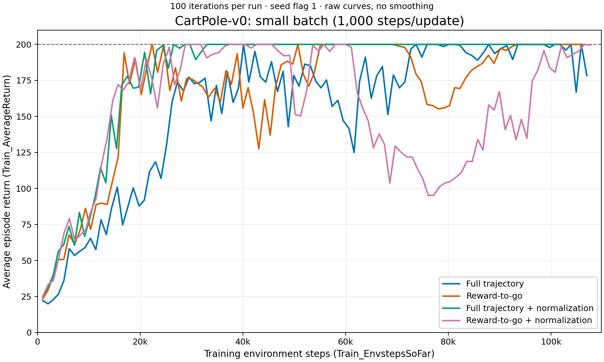
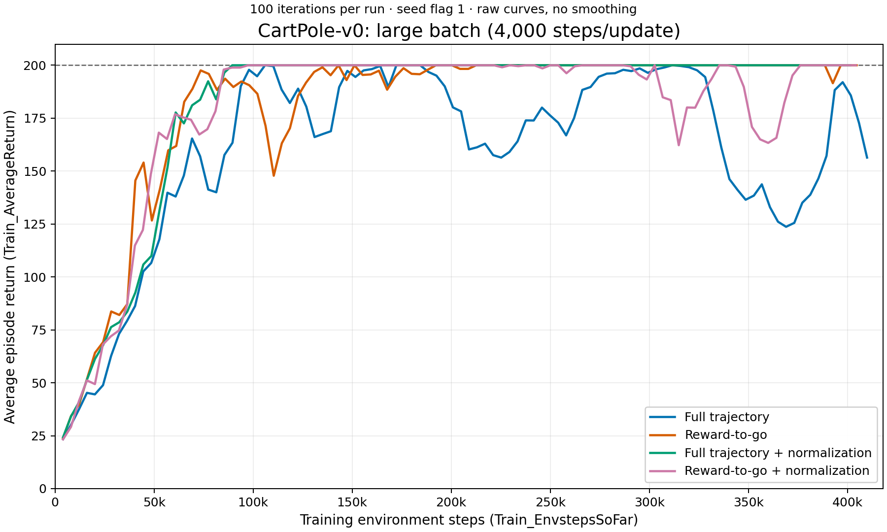

# Section 3: Vanilla policy gradients on CartPole-v0

## Plots and measurements

These plots use the eight completed runs with timestamp `20261013_100836`.
Every run contains 100 logged iterations. The x-axis is `Train_EnvstepsSoFar`,
not policy-gradient iterations; the y-axis is `Train_AverageReturn`. Curves are
raw, with no smoothing. Evaluation steps are not included in this training-step
counter. The dashed line is CartPole-v0's maximum episode return of 200.

### Small batch: 1,000 steps per update



[PDF version](cartpole_small_batch.pdf)

| Run | Final return | Mean return, last 10 iterations | First training average of 200, environment steps | Total training steps |
| --- | ---: | ---: | ---: | ---: |
| `cartpole` | 178.33 | 193.90 | 40,125 | 106,984 |
| `cartpole_rtg` | 200.00 | 200.00 | 22,313 | 106,479 |
| `cartpole_na` | 200.00 | 200.00 | 26,491 | 101,984 |
| `cartpole_rtg_na` | 199.50 | 192.03 | 28,787 | 107,687 |

### Large batch: 4,000 steps per update



[PDF version](cartpole_large_batch.pdf)

| Run | Final return | Mean return, last 10 iterations | First training average of 200, environment steps | Total training steps |
| --- | ---: | ---: | ---: | ---: |
| `cartpole_lb` | 156.38 | 159.83 | 105,999 | 409,910 |
| `cartpole_lb_rtg` | 200.00 | 199.15 | 143,084 | 404,632 |
| `cartpole_lb_na` | 200.00 | 200.00 | 89,449 | 401,449 |
| `cartpole_lb_rtg_na` | 200.00 | 197.75 | 97,488 | 404,251 |

The final-ten metric is the arithmetic mean of the ten logged training-batch
average returns, not a pooled average across episodes. The first average of 200
is a first-hit measure, not evidence of sustained convergence. All eight runs
hit 200 at least once, but some later deteriorated. There is only one run per
configuration, so these are observations from this experiment set, not
statistically established rankings. The final-ten windows also cover different
numbers of environment steps in the two batch groups.

## Answers to the assignment questions

### 1. Which estimator performs better without advantage normalization?

- **Small batch:** Reward-to-go performed better. It first reached a training
  average of 200 at 22,313 steps, versus 40,125 for full-trajectory returns,
  and its final-ten average was 200.00 versus 193.90. The final returns were
  200.00 and 178.33, respectively.
- **Large batch:** Reward-to-go had better sustained late performance: its
  final-ten average was 199.15 versus 159.83, and its final return was 200.00
  versus 156.38. However, full-trajectory returns first hit exactly 200 earlier
  (105,999 versus 143,084 steps), so reward-to-go was not better on every metric.

### 2. Why is one estimator generally preferred?

Reward-to-go is generally preferred because an action cannot affect rewards
that occurred before it. Weighting its log-probability gradient by those past
rewards adds noise without useful credit-assignment information. Removing them
typically reduces gradient variance while retaining the expected policy
gradient in this undiscounted setting. The better late performance of
unnormalized reward-to-go in both groups is consistent with this motivation,
although these runs alone do not establish the mechanism experimentally.

### 3. Did advantage normalization help?

- **Small batch:** It helped full-trajectory returns: the final-ten average
  increased from 193.90 to 200.00, and the first average of 200 occurred earlier
  (26,491 versus 40,125 steps). It did not help reward-to-go in this run: the
  final-ten average decreased from 200.00 to 192.03, with a substantial mid-run
  drop visible in the normalized curve.
- **Large batch:** It strongly helped full-trajectory returns: the final-ten
  average increased from 159.83 to 200.00, with stable performance after
  convergence. For reward-to-go it brought the first average of 200 forward
  (97,488 versus 143,084 steps), but slightly reduced the final-ten average
  (197.75 versus 199.15). Its benefit therefore depends on the estimator and
  the performance measure, rather than being universal.

Normalization centers advantages and controls their scale, which can make
optimization more stable, but does not guarantee improvement in every run.

### 4. Did batch size have an impact?

Yes, especially on sample efficiency. At 100 updates, small batches used about
102k–108k training steps, while large batches used about 401k–410k. Every
large-batch configuration first hit a training average of 200 at a higher
environment-step count than its matching small-batch configuration. For
example, full-trajectory returns with normalization needed 26,491 steps with
small batches versus 89,449 with large batches; unnormalized reward-to-go
needed 22,313 versus 143,084.

Larger batches did not consistently improve final performance: normalized
full-trajectory returns had a final-ten average of 200 in both groups, while
unnormalized full-trajectory returns were worse with large batches (159.83
versus 193.90). Normalized reward-to-go had a better final-ten average with
large batches (197.75 versus 192.03), but at roughly four times the total
interaction budget. Larger batches provide more samples per update but fewer
updates per environment step; these runs favor small batches for sample
efficiency, without proving that small batches are always preferable.

## Exact experiment commands

Run from `hw2/`. All commands used `OMP_NUM_THREADS=1`, `MKL_NUM_THREADS=1`,
`PYTHONUNBUFFERED=1`, and `WANDB_MODE=online`, and were launched with `nohup`
in the background. `--locked` uses the existing dependency lockfile.

```bash
uv run --locked src/scripts/run.py --env_name CartPole-v0 -n 100 -b 1000 --no_gpu --exp_name cartpole
uv run --locked src/scripts/run.py --env_name CartPole-v0 -n 100 -b 1000 --no_gpu --exp_name cartpole_rtg -rtg
uv run --locked src/scripts/run.py --env_name CartPole-v0 -n 100 -b 1000 --no_gpu --exp_name cartpole_na -na
uv run --locked src/scripts/run.py --env_name CartPole-v0 -n 100 -b 1000 --no_gpu --exp_name cartpole_rtg_na -rtg -na
uv run --locked src/scripts/run.py --env_name CartPole-v0 -n 100 -b 4000 --no_gpu --exp_name cartpole_lb
uv run --locked src/scripts/run.py --env_name CartPole-v0 -n 100 -b 4000 --no_gpu --exp_name cartpole_lb_rtg -rtg
uv run --locked src/scripts/run.py --env_name CartPole-v0 -n 100 -b 4000 --no_gpu --exp_name cartpole_lb_na -na
uv run --locked src/scripts/run.py --env_name CartPole-v0 -n 100 -b 4000 --no_gpu --exp_name cartpole_lb_rtg_na -rtg -na
```

Unchanged defaults: seed flag 1, discount 1.0, learning rate 0.005, two 64-unit
hidden layers, 400 evaluation steps per iteration, scalar logging every
iteration, videos disabled, no baseline, and no GAE. The episode limit is
CartPole-v0's default 200 steps. Batch collection completes whole episodes, so
actual training-step totals can exceed the nominal batch size times 100.

To regenerate both PNG and PDF plots from the saved logs:

```bash
uv run python exp/plot_section3.py
```
